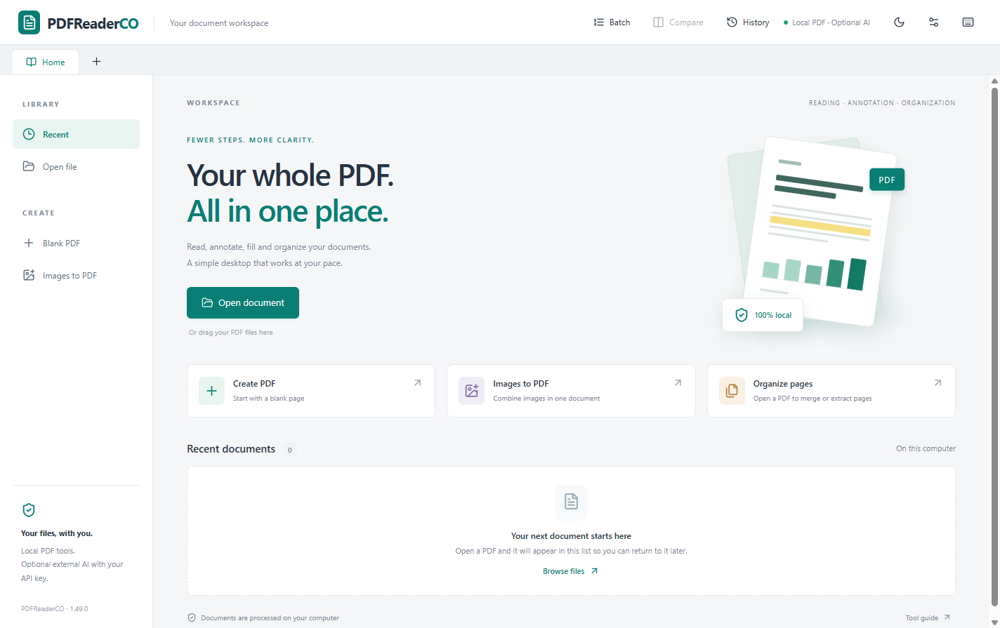
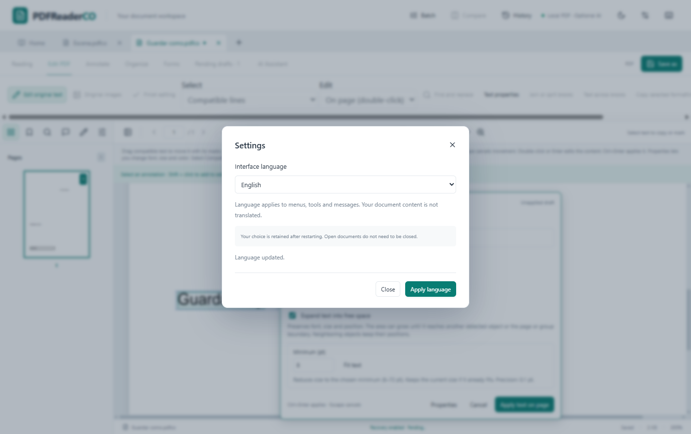
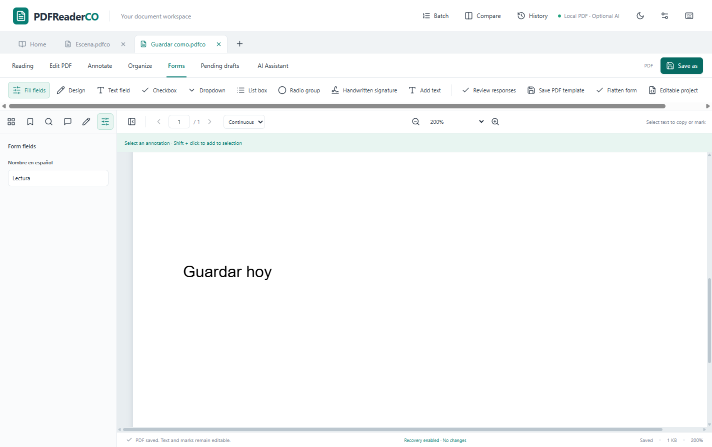
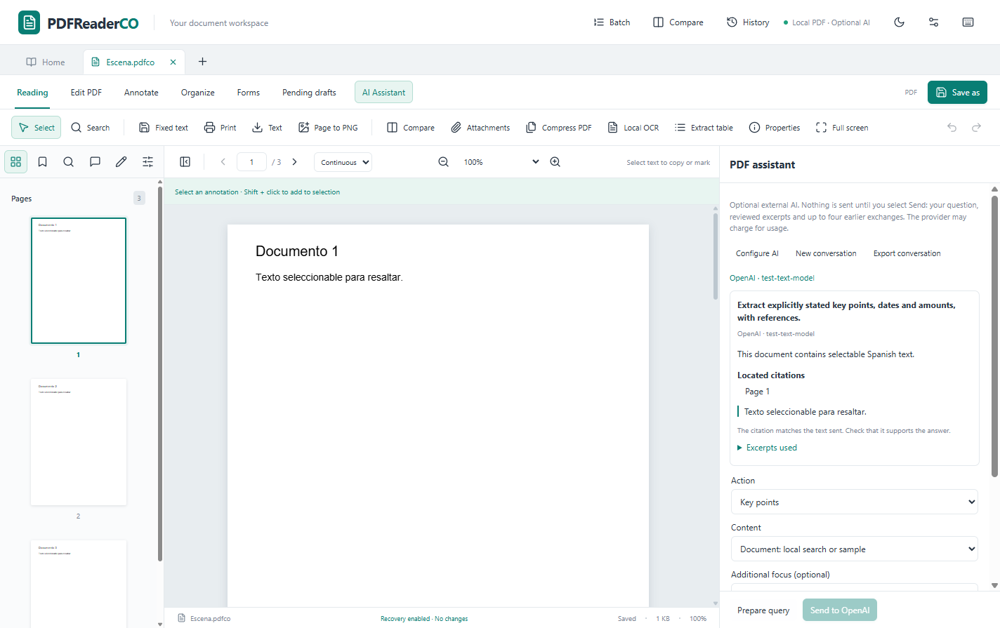
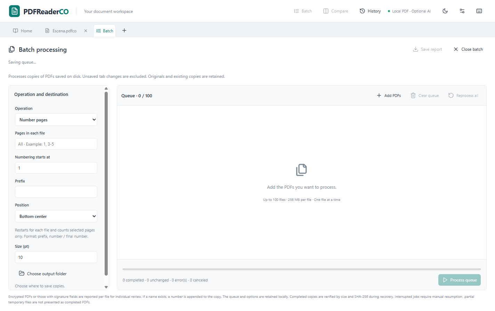

# PDFReaderCO

[English](README.en.md) · **Español** · [Funciones](docs/FEATURES.es.md) · [Compilar](docs/BUILD.es.md) · [Licencia](LICENSE)

Aplicación de escritorio para **Windows x64** para leer, editar y organizar PDF.
Incluye OCR local, formularios, anotaciones, procesamiento por lotes y un asistente
de IA opcional con tu propia API key. Interfaz en **español e inglés**.

**Uso gratuito para fines no comerciales.** Puedes modificar y redistribuir el
proyecto bajo [PolyForm Noncommercial 1.0.0](LICENSE). Esta licencia no autoriza
su explotación comercial. Los componentes de terceros conservan sus
[licencias originales](THIRD_PARTY_NOTICES.md).



## Funciones

| Área | Qué puedes hacer |
| --- | --- |
| Lectura | Pestañas, miniaturas, búsqueda, selección y copia, zoom, dos páginas, vista dividida, tema oscuro y última posición de lectura. |
| Edición | Editar texto original compatible, palabras, fragmentos y párrafos; mover, cambiar formato, ampliar el área disponible, buscar/reemplazar y trabajar con selecciones entre bloques. Editar imágenes originales compatibles. |
| Anotaciones | Resaltar, subrayar, tachar, dibujar, añadir notas, textos y figuras; mover, girar, redimensionar, duplicar y alinear objetos. |
| Formularios | Crear y completar texto, casillas, listas y botones de opción; formatos, validaciones, cálculos, diseño con el mouse y aplanado de una copia. |
| OCR local | Español, inglés, francés, alemán, italiano y portugués; zonas, revisión, correcciones, orientación, perspectiva, capa de texto invisible y exportación. |
| Páginas | Reordenar por arrastre, combinar, insertar, duplicar, girar, extraer, eliminar y recortar; numerar y añadir marcas de agua. |
| Comparación | Dos documentos en paralelo, desplazamiento sincronizado, diferencias de texto/apariencia e informes. |
| Exportación | PDF, proyecto editable `.pdfco`, TXT, PNG y tablas a CSV/XLSX con cuadrícula corregible. |
| Herramientas | Compresión con perfiles y vista previa; índice interno editable, archivos adjuntos, impresión y metadatos. |
| Lotes y recuperación | Colas con progreso, cancelación y reintentos; copias automáticas, historial y recuperación de borradores. |
| IA opcional | Preguntas sobre el documento, resúmenes, puntos clave, requisitos/tareas y explicaciones con citas por página. OpenRouter, OpenAI o Claude. |

Consulta el [detalle de funciones y límites](docs/FEATURES.es.md).

## Empezar

Para ejecutar una distribución de Windows, extrae **todo** el ZIP de la aplicación
y abre `Abrir PDFReaderCO.cmd`. Conserva los demás archivos en la misma carpeta.
No necesitas Node.js para una distribución ya compilada. El ZIP de **Code → Download
ZIP** contiene código fuente y necesita compilarse; no es un ejecutable.

Para ejecutar desde el código fuente, con Windows x64 y Node.js 22 LTS (22.13+) con npm:

```powershell
npm ci
npm run build
npm run desktop
```

Para producir una distribución:

```powershell
npm run dist:folder
```

Se genera en `release/PDFReaderCO-1.49.1-Carpeta/`.
Consulta la [guía de compilación y pruebas](docs/BUILD.es.md).

## Idioma

Abre **Configuración → Idioma de la interfaz → Español / English → Aplicar idioma**.
El cambio es inmediato y se conserva al reiniciar. El contenido del PDF, nombres
de campos, notas y borradores conserva su idioma original.



## Formularios y edición

Diseña campos sobre la página con el mouse y conserva su interactividad al guardar.
La edición original depende de la estructura del PDF, las fuentes, las máscaras y
el espacio disponible; un PDF no se redistribuye como un documento de Word.



## IA con tu propia API key

En **Asistente IA → Configurar IA**, elige OpenRouter, OpenAI o Claude e introduce
tu API key y un modelo compatible con tu cuenta. Prepara la consulta, revisa los
extractos y pulsa **Enviar**. Puedes conservar la clave solo durante la sesión o
recordarla cifrada en Windows cuando el almacenamiento seguro está disponible.

La IA requiere Internet y el proveedor puede cobrar su uso. El texto enviado
incluye tu pregunta, los extractos revisados y el contexto de conversación que
indique la vista previa. Las herramientas PDF y el OCR funcionan localmente.
Los escaneos necesitan OCR para proporcionar texto al asistente. Revisa las
respuestas y sus citas antes de utilizarlas.



Esta captura utiliza un documento sintético y una respuesta simulada de prueba;
no muestra una llamada real ni credenciales de un proveedor.

## Procesamiento por lotes

Aplica numeración, marcas de agua, extracción, compresión u OCR a varios archivos,
con seguimiento de cada resultado y copias con nombres independientes.



Las capturas muestran la interfaz 1.49.0 con documentos sintéticos. La publicación
1.49.1 añade documentación y licencia sin cambiar esos flujos.

## Límites y licencia

- La edición original admite estructuras compatibles; algunas fuentes, máscaras
  y objetos pueden impedir una operación.
- El OCR puede cometer errores y requiere revisión, especialmente con manuscritos,
  fotografías difíciles y diseños complejos.
- La firma manuscrita es visual; no equivale a una firma digital con certificado.
- Las distribuciones actuales no tienen firma Authenticode propia. Su ejecución
  depende de las políticas de Windows del equipo.
- El proyecto es independiente y no está afiliado a Adobe ni a PDF Reader Pro.
  No incluye su código, marcas gráficas ni recursos.

La licencia no comercial se aplica al código original de esta publicación y a
sus modificaciones cubiertas por ella. No cambia las licencias de terceros ni
revoca permisos ya concedidos sobre copias anteriores. Es **código disponible
para uso no comercial**, no una licencia de código abierto sin restricciones
de uso. Lee [LICENSE](LICENSE), [NOTICE](NOTICE) y los
[avisos de terceros](THIRD_PARTY_NOTICES.md).

Para informar errores o proponer cambios, consulta [CONTRIBUTING.md](CONTRIBUTING.md).
